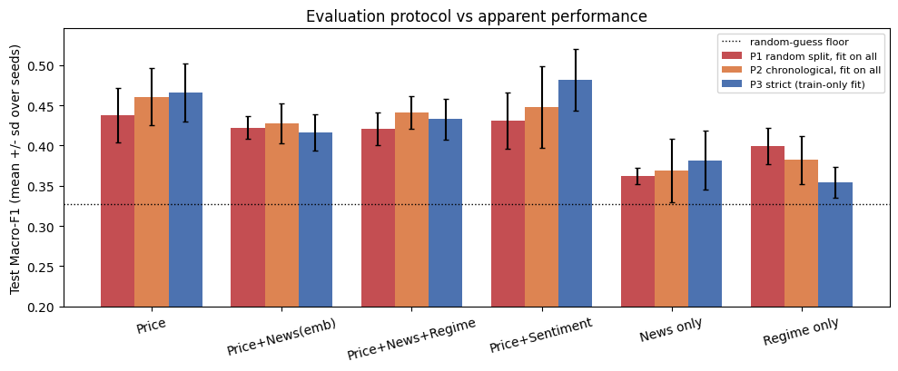
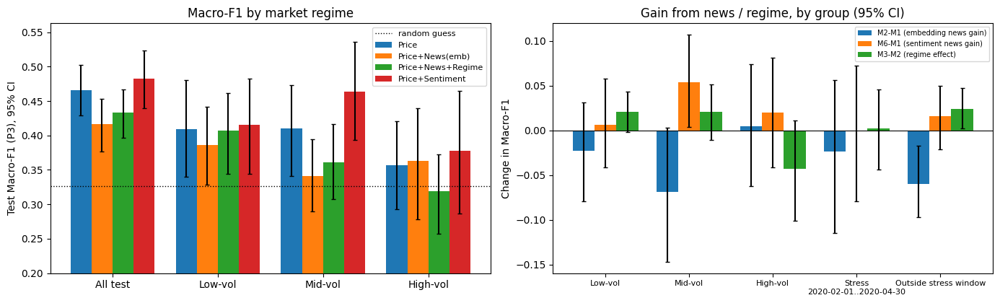
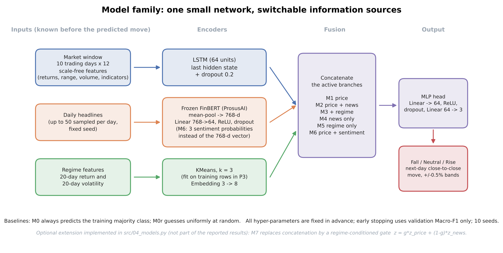
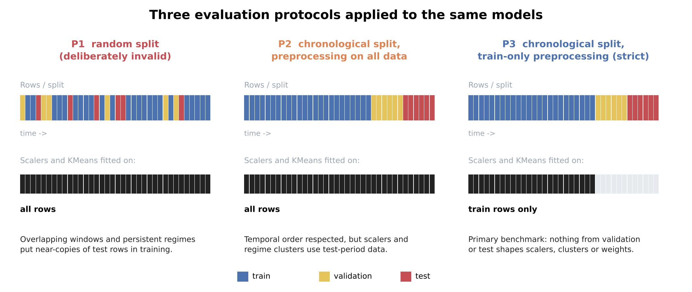
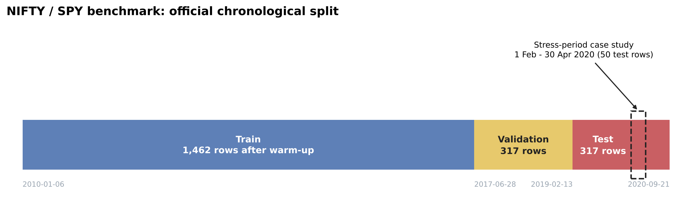

# Regime-Aware Multimodal Deep Learning for Financial Market Forecasting
### Evaluation robustness and regime-dependent news value

## Undergraduate Thesis — IIT Kharagpur

This repository contains the implementation and experimental record for a bachelor's thesis investigating the reliability of multimodal financial market prediction under different evaluation protocols and market conditions.

The central premise of the study is that reported predictive performance can depend not only on the model architecture, but also on **how the experiment is constructed and evaluated**. The project therefore treats evaluation protocol as a first-class experimental variable and examines whether financial news contributes information beyond historical market data, particularly during periods of elevated market stress.

---

## Research Questions

### RQ1 — Evaluation sensitivity

**How much do reported market-prediction results change when the same models are evaluated under increasingly strict temporal protocols?**

The study compares model performance under three protocols:

- **P1 — Random / permissive:** random splitting with preprocessing performed using the complete dataset. This serves as an intentionally permissive reference and is not treated as a valid deployment-style evaluation.
- **P2 — Chronological:** temporally ordered train/test evaluation while retaining broader preprocessing.
- **P3 — Strict chronological:** temporally ordered evaluation with preprocessing restricted to the training data, providing the primary leakage-controlled benchmark.

The objective is not simply to identify the highest-performing protocol, but to quantify how much the apparent performance of the same models changes as evaluation becomes more rigorous.

### RQ2 — Incremental value of financial news

**Does financial news provide predictive information beyond historical price data, and does its contribution vary across market regimes and periods of market stress?**

News is represented using frozen FinBERT-derived features and evaluated alongside price-based and regime-aware models. Performance is examined both over the full test period and within distinct volatility regimes, with a dedicated analysis of the February–April 2020 stress window.

---

## Headline findings (10 seeds, strict protocol P3, test Macro-F1)

| Model | Inputs | Test Macro-F1 (mean ± sd) |
|---|---|---:|
| M0 | majority class | 0.207 ± 0.000 |
| M0r | uniform random guess | 0.333 ± 0.020 |
| M1 | price window | 0.466 ± 0.036 |
| M2 | price + FinBERT embedding | 0.416 ± 0.023 |
| M3 | price + embedding + regime | 0.433 ± 0.025 |
| M4 | news only | 0.382 ± 0.037 |
| M5 | regime only | 0.354 ± 0.019 |
| M6 | price + 3 FinBERT sentiment scores | 0.482 ± 0.038 |

* The majority baseline is a misleading floor for Macro-F1 (0.207); the random-guess floor is 0.333.
* **News embeddings did not help.** M2 − M1 = −0.050 (95% CI −0.087 to −0.012); M2 fits training data much better than M1 (0.554 vs 0.477) but generalises worse.
* **Compact sentiment is about neutral.** M6 − M1 = +0.016 (CI −0.017 to +0.049), not significant. M6 was added after seeing early results, so this is exploratory.
* **Protocol effects are small and model-dependent**, not uniform inflation. Only M5 (loose protocols score higher, P1 − P3 = +0.046) and M6 (strict protocol scores higher, −0.051) have intervals excluding zero.
* **Regime and stress window:** no consistent news benefit. The one isolated significant interval (M6 − M1 in Mid-vol, +0.054 [0.004, 0.107]) is one of about 24 comparisons and is treated as a hypothesis. In the Feb–Apr 2020 stress window (n = 50) every news difference has a wide interval around zero.

Full tables with confidence intervals: [`results/EXECUTED_RESULTS.md`](results/EXECUTED_RESULTS.md). Raw cell outputs: [`results/logs/`](results/logs).




---

## Design





* **Data:** NIFTY (SPY, 2,111 rows, official chronological split; 1,462 / 317 / 317 after dropping 15 warm-up rows). The label of row t is the **next trading day's** close-to-close move (Fall < −0.5%, Rise > +0.5%). Details and caveats: [`data/STEP1_AUDIT.md`](data/STEP1_AUDIT.md).
* **Price input:** 10 trading days × 12 scale-free features from a daily series recovered from the dataset's contexts. **News:** up to 50 sampled headlines per day through frozen ProsusAI/finbert (768-d mean pool, plus 3 sentiment probabilities). **Regimes:** 3-state KMeans on 20-day return and log volatility, named Low/Mid/High-vol by volatility rank.
* **Protocols:** P1 random split with preprocessing on all rows (deliberately invalid); P2 chronological with preprocessing on all rows; P3 chronological with train-only preprocessing (primary).
* **Training (frozen, never tuned on test):** LSTM 64, dropout 0.2, news MLP 768→64, regime embedding 8, lr 1e-3, weight decay 1e-4, batch 64, ≤ 50 epochs, patience 8 on validation Macro-F1, class-weighted loss, 10 seeds.
* **Inference:** bootstrap over test rows (1,000 draws) for differences; seed bootstrap for protocol gaps.

## Repository map

```text
src/            01_data.py  02_regimes.py  03_finbert.py  04_models.py  05_analysis.py  06_diagrams.py
notebooks/      BTP_pipeline_executed.ipynb   (the run that produced all numbers)
results/        EXECUTED_RESULTS.md, logs/    (raw cell outputs)
figures/        eda_overview, regimes_overview, fig_protocol_audit, fig_regime_news_value, fig_architecture, fig_protocol_design, fig_dataset_timeline
data/           STEP1_AUDIT.md                (data files are regenerated, not committed)
literature/     references.md, papers.csv     (reading list, see status inside)
report/         results_draft.md, README.md
presentation/   slide_outline.md
config.py       reference copy of the frozen settings
```

## Reproduce

```bash
pip install -r requirements.txt
export BTP_ROOT=/path/to/workdir      # default: /content/drive/MyDrive/btp (Colab)
python src/01_data.py   # downloads NIFTY, builds the daily series, audits timing
python src/02_regimes.py
python src/03_finbert.py   # GPU recommended
python src/04_models.py    # 270 runs, ~6-8 min on CPU
python src/05_analysis.py
python src/06_diagrams.py  # no data needed
```
The scripts are written as `# %%` cells and were run cell by cell in Colab. The command-line path was tested end-to-end only on a synthetic mock dataset; the reported numbers come from the notebook.

## Transparency

* M6 (price + sentiment scores) and the random-guess baseline M0r were added after the first results were seen.
* About 24 comparisons are reported; isolated significant intervals are hypotheses.
* Test rows are overlapping daily observations, so intervals are likely somewhat optimistic. The test period is one 20-month stretch dominated by the 2020 shock.
* The amount and nature of headlines changes across eras (277, 54 and 26 per day in train, validation and test).
* **Implemented but not run on real data:** M7 (regime-gated fusion) in `src/04_models.py` and the `LAG = 1` robustness option. They are not part of the results.
* This is a methodological study, not a trading system. Nothing here shows exploitable returns.

Literature status: see [`literature/references.md`](literature/references.md); it is a reading list, not a completed review.
